# PaletteDesk Shell

A Hyprland + Quickshell rice. A Hyprland (Lua config) desktop with a custom Quickshell shell: bar, launcher, control center,
notifications, lock screen, settings panel with themes and keybind editor, 32-band equalizer,
live lyrics, wallpaper picker with search, album-cover wallpapers with a visualizer, and screen
recording. Colors follow the wallpaper through matugen (kitty, GTK, Qt, fish, Hyprland, Firefox).

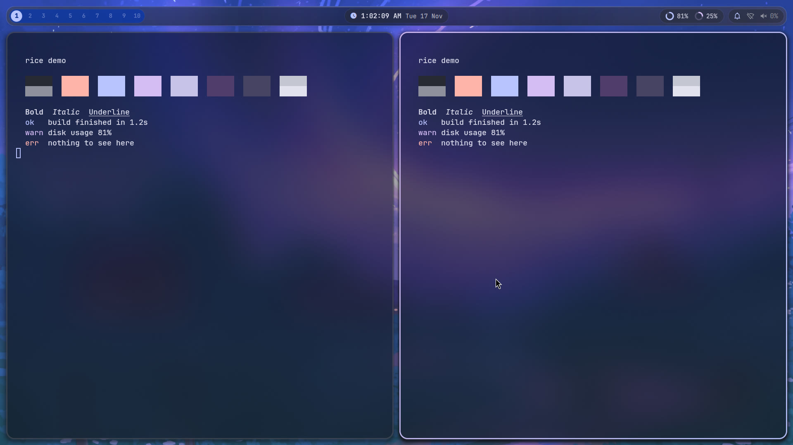

| Launcher | Control center |
| --- | --- |
| 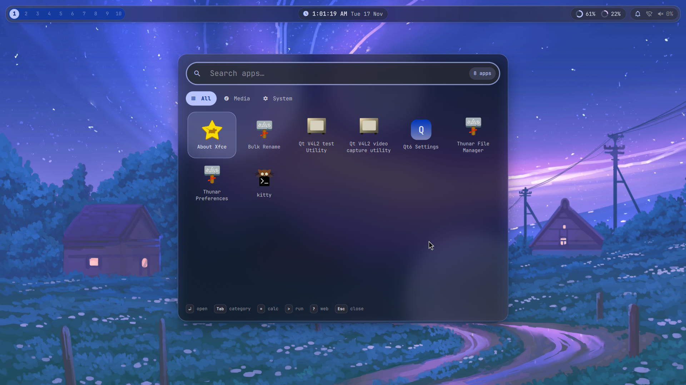 | 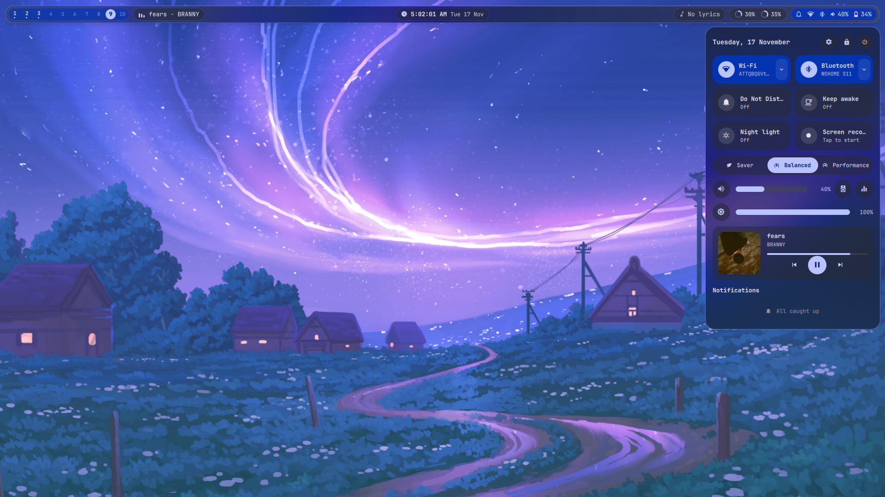 |
| **Settings** | **Wallpaper picker** |
| 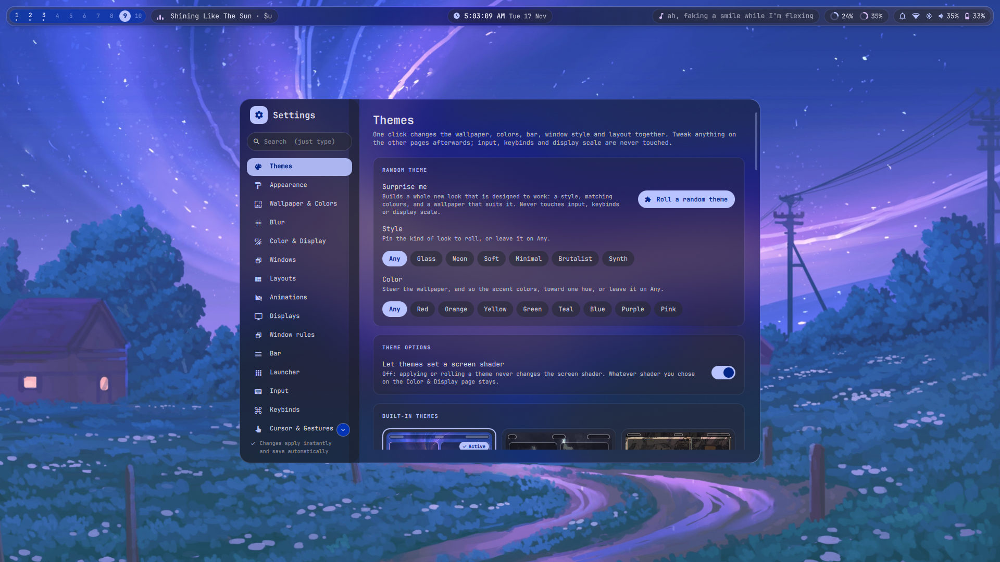 | 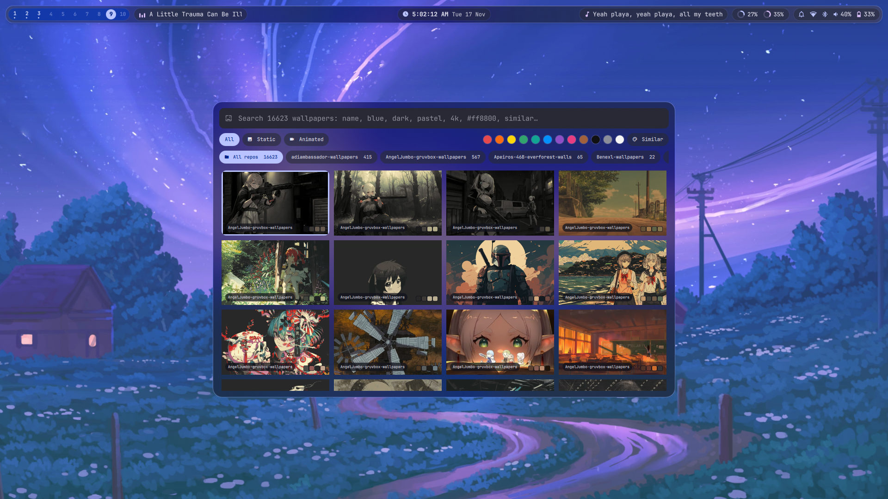 |
| **32-band equalizer** | |
| 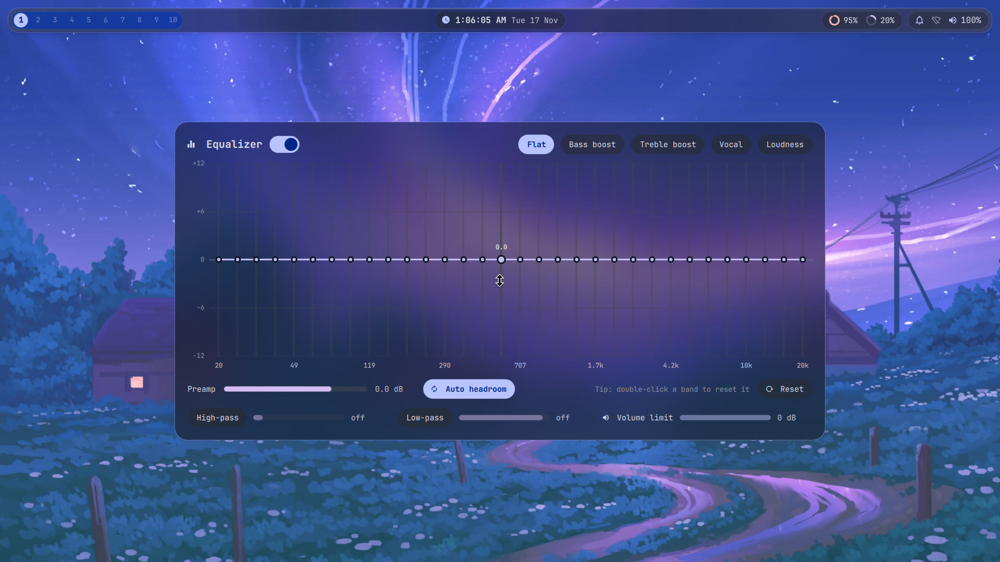 | |

## Themes

Nine built-in themes (Settings → Themes), each a full look: wallpaper, colors, bar style, gaps, blur and animations. You can save your own too.

| **Frosted Glass** | **Mocha Islands** | **Gruvbox Workshop** |
| --- | --- | --- |
| 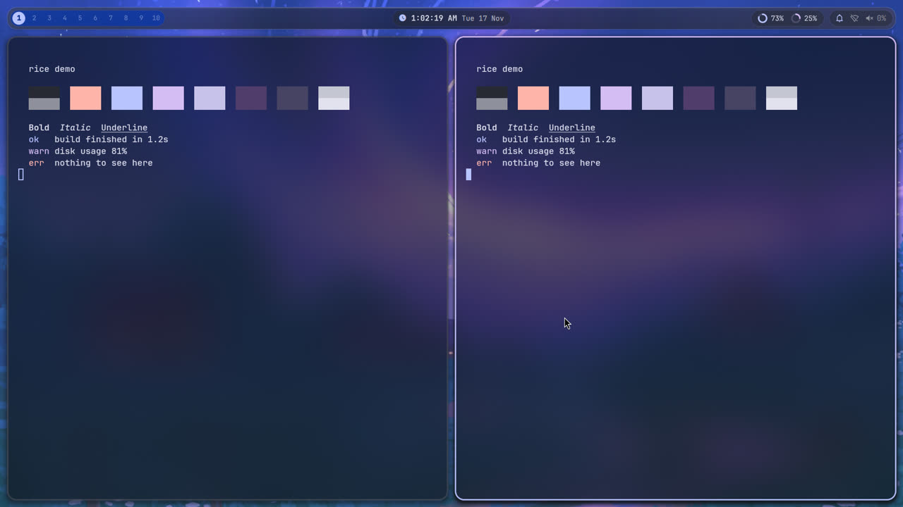 | 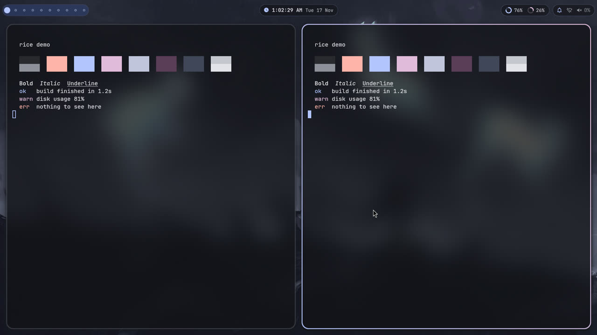 | 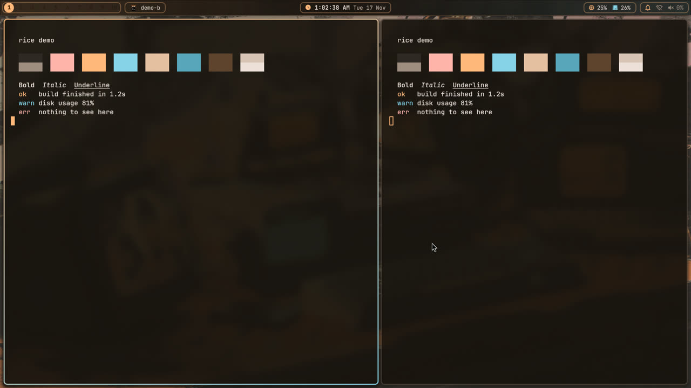 |
| **Nordic Taskbar** | **Everforest Zen** | **Rosé Pine Soft** |
| 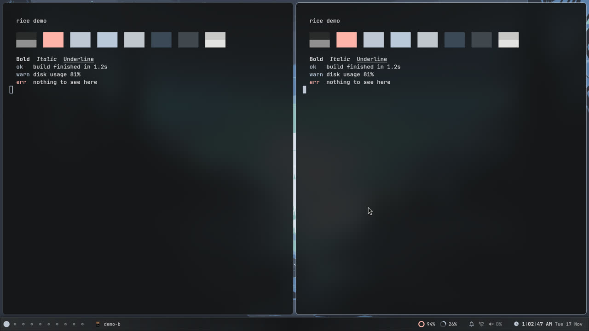 | 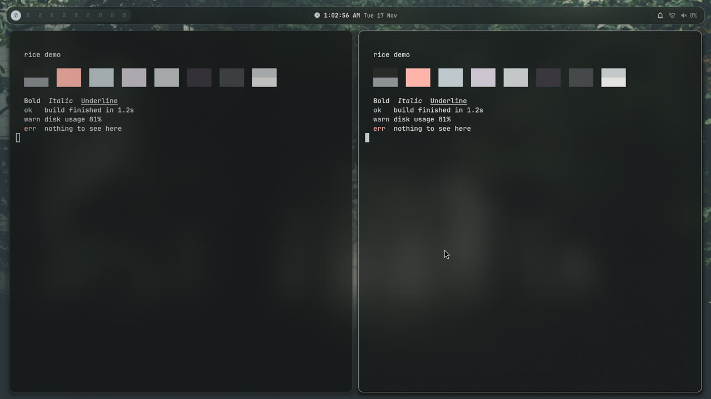 | 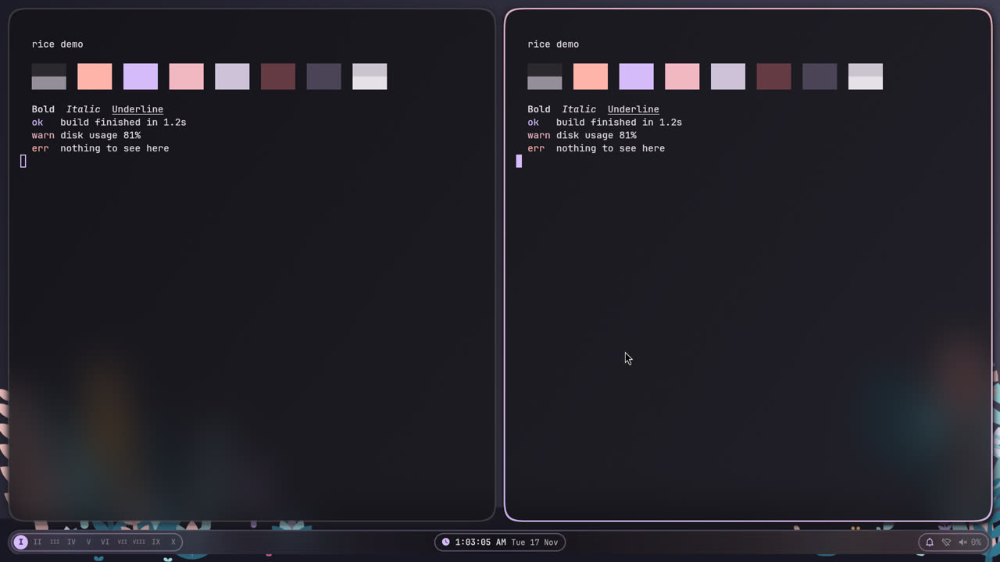 |
| **Pixel Den** | **Mono Focus** | **Neon Transit** |
| 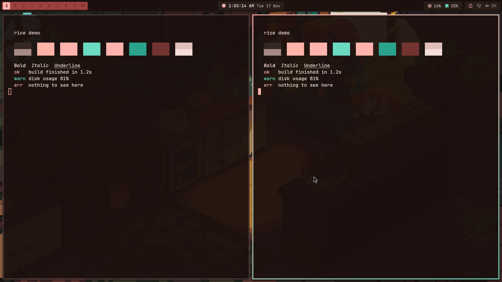 | 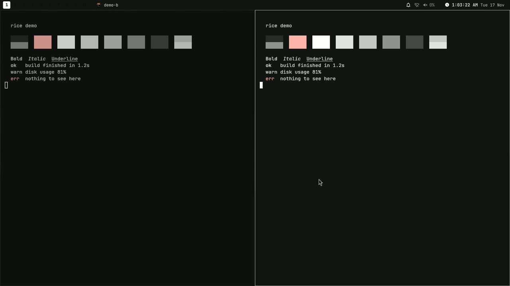 | 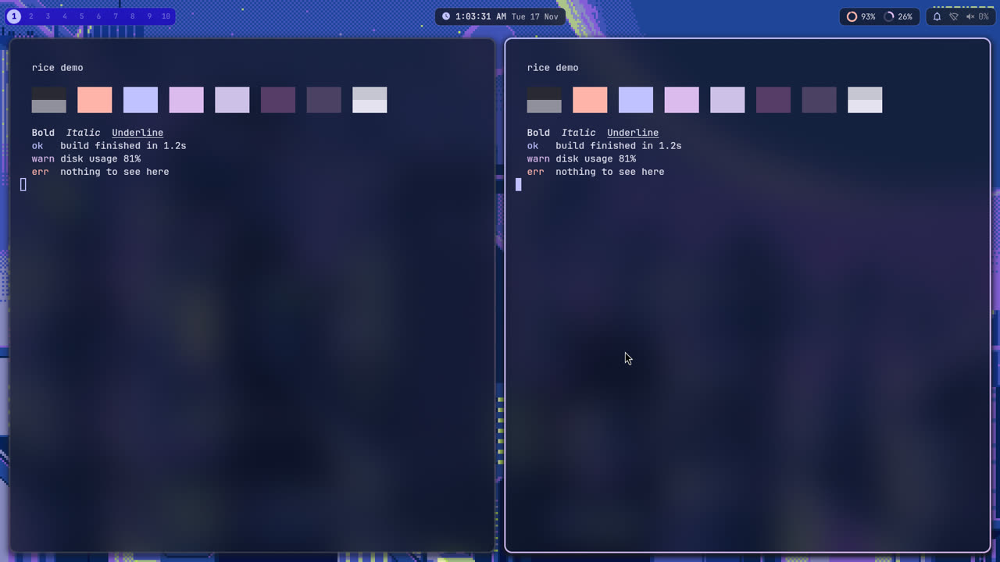 |

## Requirements

- Arch Linux or an Arch-based distro (the installer uses pacman)
- **Hyprland 0.57 or newer** (this config is `hyprland.lua`, not the old `.conf`)
- A Wayland session you can log in to; NetworkManager and bluetoothd running for the Wi-Fi/Bluetooth tiles

## Install

```sh
git clone https://github.com/fruttibarr/palettedesk-shell && cd palettedesk-shell
./install.sh --dry-run      # see exactly what it would do
./install.sh                # for real
```

Options: `--yes` (no prompts), `--no-packages`, `--wallpapers` (download the theme wallpapers), `--aur` (optional AUR extras), `--firefox`
(install the Firefox theme into your default-release profile).

The installer:
- asks before running `sudo pacman -S --needed` (lists in `packages/`)
- moves anything it would replace to `~/.local/state/rice-install/backup-<time>/`
- never overwrites an existing `~/.config/rice/settings.json`
- generates colors (`set-wallpaper.sh`) and the equalizer config (`gen-eq.py`)
- never runs as root, never enables services, never touches `/etc`

It replaces these in `~/.config`: `quickshell/`, `hypr/hyprland.lua`, `matugen/`, `kitty/kitty.conf`,
`fish/config.fish`, `fish/functions/fish_prompt.fish`, `qt6ct/qt6ct.conf`; matugen then rewrites the
GTK stylesheets and the generated `*colors*` files.

Re-running is safe: identical files are skipped.

## Install on NixOS

NixOS is declarative, so the system part is a module and the per-user part is a script:

1. Import the module in your configuration (it enables the Hyprland session, PipeWire, polkit,
   NetworkManager, Bluetooth, fonts and every package the rice needs) and rebuild:
   ```nix
   imports = [ /path/to/palettedesk-shell/nixos/module.nix ];
   users.users.<you>.extraGroups = [ "ydotool" ];   # only for "middle click acts as right click"
   ```
   ```sh
   sudo nixos-rebuild switch
   ```
2. Log out and back in, then run the installer as your user:
   ```sh
   ./nixos/install-nixos.sh --dry-run
   ./nixos/install-nixos.sh
   ```
   It checks the module's pieces are in place, backs up anything it replaces, copies the config and
   generates the colors and the equalizer config. It never edits `/etc/nixos`.
   No module? `--profile` installs just the user-level packages with `nix profile add`; Hyprland,
   PipeWire and the rest still have to come from your system configuration.

The module uses `lib.mkDefault` throughout, so your own settings win. It needs nixpkgs-unstable
(Hyprland 0.57+ for the Lua config). Qt's multimedia module is added for video wallpapers, which
nixpkgs' Quickshell does not bundle.

## After installing

1. Log in to the Hyprland session, or from a TTY run `start-hyprland` (don't launch the bare `Hyprland` binary).
2. Wallpapers: put images in `~/Pictures/Wallpapers`, or run `./install.sh --wallpapers` / `scripts/fetch-wallpapers.sh` to download just the 9 wallpapers the
   built-in themes use (about 37 MB, one file each straight from its author's GitHub repo). They belong to their
   authors and are not included in this repository; check each repo's license before reusing them.
3. Optional: `sudo pacman -S swh-plugins` for the equalizer's real limiter.
4. Optional: Settings → Input → "Middle click acts as right click" runs a one-time ydotool setup (asks for your password).

## Default keys

Super+Space launcher, Super+Enter terminal, Super+A control center, Super+Shift+A equalizer,
Super+, settings, Super+W wallpapers, Super+V clipboard, Super+L lock, Print/Ctrl+Print screenshot/record.
All rebindable in Settings → Keybinds.

## Network access

The shell works offline, but a few features talk to the internet. All of them are optional:

- **Live lyrics** send the playing track's title, artist, album and length to [LRCLIB](https://lrclib.net)
  (results are cached in `~/.cache/rice/lyrics`). Remove `lyrics` from the bar layout to stop this.
- **Album-cover wallpaper** downloads the cover image from the URL your media player provides.
- **Launcher web search** (`?` prefix) opens your chosen search engine in your browser.
- **Installer:** `pacman` downloads packages; `--wallpapers` downloads 9 files from `raw.githubusercontent.com`.

Nothing is sent anywhere else, and there is no telemetry.

## Tested on

- Arch Linux in a clean virtual machine (QEMU/KVM, software rendering, 1920x1080) with Hyprland 0.57.2
  and Quickshell 0.3.2: install, a second run, all nine themes, the launcher, control center, equalizer,
  settings, wallpaper picker, lock screen, keybinds, notifications, and the equalizer's limiter.
- NixOS (unstable) in a clean VM: the module builds, `install-nixos.sh` and its `--profile` option run,
  Hyprland starts with no config errors, the equalizer runs with its limiter, GIF and video wallpapers animate.
- Day-to-day on a 14" laptop.

**Not tested:** the `--aur` and `--firefox` options (Arch and NixOS); NixOS on real hardware on a real profile; Wi-Fi and Bluetooth tiles with real
hardware in a fresh install; screen recording and audio output in the VM; other distributions.

## Credits

Built on the work of others:

- [Hyprland](https://hypr.land) (window manager; `hyprland.lua` started from its example config) and
  [Quickshell](https://quickshell.org) (the shell toolkit)
- [matugen](https://github.com/InioX/matugen) (wallpaper-derived colors), [cava](https://github.com/karlstav/cava)
  (audio visualizer), [cliphist](https://github.com/sentriz/cliphist), [grim](https://sr.ht/~emersion/grim/),
  [slurp](https://github.com/emersion/slurp), [wf-recorder](https://github.com/ammen99/wf-recorder),
  [ydotool](https://github.com/ReimuNotMoe/ydotool), [PipeWire](https://pipewire.org) and
  [swh-plugins](https://github.com/swh/ladspa) (the equalizer's limiter)
- [LRCLIB](https://lrclib.net) for synced lyrics
- [JetBrains Mono](https://www.jetbrains.com/lp/mono/) (Nerd Fonts build)
- Wallpapers used by the built-in themes belong to their authors and are not part of this repository; the
  download script fetches them from: AngelJumbo/gruvbox-wallpapers, Apeiros-46B/everforest-walls,
  DenverCoder1/minimalistic-wallpaper-collection, linuxdotexe/nordic-wallpapers,
  orangci/walls-catppuccin-mocha, rose-pine/wallpapers, whoisYoges/lwalpapers and elapse-d/foo-Wallpaper-Feh-Gif.
  The screenshots in this README show those wallpapers. If you are an author and want something removed, open an issue.

## Maintenance

The installer puts a `palettedesk` command in `~/.local/bin` (add that folder to your `PATH` if it isn't already):

```sh
palettedesk version            # installed version and commit
palettedesk doctor             # checks commands, services, config errors, shell memory
palettedesk update             # git pull your clone, re-run the installer (settings kept; --check to preview)
palettedesk mem --watch        # log the shell's memory every minute to ~/.local/state/rice/mem.log
palettedesk restore            # list the backups the installer made
```

If the shell ever uses a lot of memory, a notification with a **Restart shell** button appears (limit in
Settings > Behavior > Shell health, default 1500 MB, 0 turns it off). Nothing restarts without you.
If a wallpaper isn't animating, `qs ipc call shell wallState` says why.

## Uninstall

```sh
palettedesk uninstall --dry-run   # see exactly what would happen
palettedesk uninstall             # remove what the installer put down, restore your previous config
palettedesk uninstall --purge     # ...and also delete your settings, saved themes and caches
```

Files you edited after installing are moved to a backup instead of being deleted, and your original config is
restored from the installer's backup. `--system` also undoes the one-time ydotool setup (it prints the sudo
commands). On NixOS, also remove the `nixos/module.nix` import and rebuild.

## Development

```sh
python3 tests/lint-settings.py     # settings, theme keys, Hyprland mappings and IPC targets stay in sync
tests/vm/arch-vm.sh up             # disposable Arch VM (QEMU/KVM); see the script header for push/install/hypr/shot
tests/soak.sh -n 100 FILE...       # cycle wallpapers and popups and sample the shell's memory
```

CI runs the lint, shellcheck, Lua/Python syntax checks, an Arch install, uninstall and a NixOS evaluation
(`.github/workflows/ci.yml`). Run `palettedesk doctor` first when reporting a bug.

## Layout

```
install.sh            installer
LICENSE               MIT
nixos/                NixOS module, installer and a test VM definition
packages/             pacman.txt, optional.txt, aur.txt
config/               files copied into ~/.config
scripts/              fetch-wallpapers.sh, palettedesk (the maintenance command)
tests/                settings lint, VM harness, soak test
.github/workflows/    CI
```

## License

[MIT](LICENSE) for the code and configuration in this repository. Third-party software and wallpapers keep
their own licenses.
